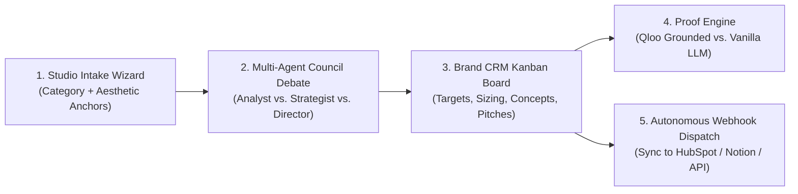

# ⚡ Venture Pulse
### Autonomous Cultural Intelligence & Brand Collaboration Agent for Creators & Indie Studios

[](file:///C:/dev/QlooAgent/LICENSE)
[-black.svg)](https://nextjs.org/)
[](https://sdk.vercel.ai/)
[](https://qloo.com)
[](https://www.typescriptlang.org/)
[](https://tailwindcss.com/)

> **Qloo Agentic Hackathon 2026 Submission**  
> *Transforming cultural taste into actionable commercial partnerships and merchandise collaborations with zero generic hallucinations.*

---

## 🌟 The Vision: Eliminating AI's "Cultural Blindness"

Modern AI agents can code, reason, and write persuasive prose, but when asked what brand to partner with or what merchandise people will actually buy, **they are guessing**. Standard LLMs hallucinate generic clichés:
* *"Sell logo coffee mugs, t-shirts, and stickers."*
* *"Pitch generic sponsors like VPNs, mattress companies, and meal kits."*

These recommendations fail because they ignore the authentic, multi-dimensional subcultures of modern fanbases.

**Venture Pulse fixes this.** Powered by **Qloo’s 250M+ entity Taste Graph**, Venture Pulse gives autonomous agents real cultural grounding. It bridges a creator's artistic DNA (cinema, indie music, fashion, literary aesthetics) to mathematically verified consumer brand affinities, turning cultural alignment into high-converting brand collaborations and physical merchandise concepts.

---

## 🚀 Key Features



### 1. 3-Step Guided Studio Wizard
Creators and hackathon judges can enter a project profile in seconds or choose from 3 instant pre-seed archetypes:
* **The Neon Void Studio:** Cyberpunk synthwave game studio.
* **Botanical Frequencies:** Lo-fi ambient wellness podcast.
* **Analog Nostalgia:** 35mm film photography and vintage vinyl creator.

### 2. Multi-Agent Council Debate
Watch 3 specialized sub-agents deliberate in real time via live Server-Sent Events (SSE):
* 🕵️ **Cultural Analyst:** Traverses Qloo's Taste Graph to calculate empirical cross-domain affinity scores.
* 📈 **Brand Strategist:** Evaluates market feasibility, deal size tiers ($2k–$50k+), and brand safety.
* 🎨 **Creative Director:** Designs the physical collaboration product, limited-edition drop mechanics, and packaging aesthetics.

### 3. Actionable Brand CRM Kanban Board
Generated partnership targets populate an interactive, drag-and-drop Kanban board:
* **Discovered $\rightarrow$ Vetted $\rightarrow$ Pitch Ready $\rightarrow$ Dispatched**
* Complete with target deal sizing, empirical affinity multipliers (e.g. *7.8× baseline*), custom product concepts, and editable outreach pitch letters.

### 4. Interactive "Proof Engine" (Why Qloo Matters)
Directly addresses the hackathon's #1 judging criteria: *"If your submission works without Qloo, you're building the wrong thing."*
A side-by-side split screen compares:
* **Vanilla LLM:** Superficial, cliché merchandise and generic sponsor guesses.
* **Venture Pulse (Qloo Grounded):** Deep subcultural affinities backed by empirical entity graphs and authentic crossover rationale.

### 5. Autonomous CRM Webhook Dispatch
With one click, the agent dispatches the finalized collaboration brief and pitch draft to external webhooks (HubSpot, Notion, or custom CRM endpoints).

---

## 🛠️ Architecture & Tech Stack

| Layer | Technology |
| :--- | :--- |
| **Frontend Framework** | Next.js 14 (App Router), TypeScript, Tailwind CSS, Lucide Icons |
| **Agentic Orchestrator** | Vercel AI SDK Core with Multi-Agent Council State Machine |
| **Cultural Intelligence** | Qloo Taste AI™ API (250M+ Entity Cross-Domain Taste Graph) |
| **LLM Inference** | Multi-Provider Gateway: Google Gemini 1.5 Pro, OpenAI GPT-4o, and SumoPod / OpenAI-compatible endpoints |
| **Storage & Persistence** | Frictionless Client-First Hybrid (IndexedDB/LocalStorage) with Prisma/PostgreSQL schema |
| **Tool Protocol** | 6-Skill Modular Agent Protocol validated via Zod Schemas |
| **Deployment** | Vercel Edge Serverless Deployment |

---

## 📂 Documentation Suite

Explore the comprehensive technical specifications in the `docs/` folder:

* 📘 [MASTERPLAN.md](file:///C:/dev/QlooAgent/docs/MASTERPLAN.md) — Comprehensive Masterplan, Executive Strategy, and Roadmap
* 📐 [ARCHITECTURE.md](file:///C:/dev/QlooAgent/docs/ARCHITECTURE.md) — Detailed System Architecture, State Machine, and Sequence Diagrams
* 🗄️ [ERD.md](file:///C:/dev/QlooAgent/docs/ERD.md) — Entity Relationship Diagram, Data Models, and TypeScript Interfaces
* 🤖 [AGENT_SKILLS.md](file:///C:/dev/QlooAgent/docs/AGENT_SKILLS.md) — The 6-Agent Skill Protocols and Zod Tool Schemas
* 🔌 [API_INTEGRATION.md](file:///C:/dev/QlooAgent/docs/API_INTEGRATION.md) — Qloo API Client, Caching, and Multi-Provider LLM Gateway
* 🔒 [SECURITY.md](file:///C:/dev/QlooAgent/docs/SECURITY.md) — Security Architecture, Key Isolation, and Privacy Safeguards

---

## ⚡ Quick Start / Local Setup

### Prerequisites
* Node.js 18.17+ or Node.js 20+
* npm, pnpm, or yarn
* A Qloo API Key ([Get one from Qloo](https://docs.qloo.com/))
* An LLM API Key (Google Gemini, OpenAI, or SumoPod)

### Installation

1. **Clone the repository:**
   ```bash
   git clone https://github.com/your-username/venture-pulse.git
   cd venture-pulse
   ```

2. **Install dependencies:**
   ```bash
   npm install
   ```

3. **Configure Environment Variables:**
   Copy the example environment file:
   ```bash
   cp .env.example .env.local
   ```
   Edit `.env.local` with your API keys:
   ```env
   QLOO_API_KEY=your_qloo_api_key_here
   QLOO_API_BASE_URL=https://api.qloo.com

   AI_PROVIDER=google
   GEMINI_API_KEY=your_gemini_api_key_here
   ```

4. **Run the local development server:**
   ```bash
   npm run dev
   ```
   Open [http://localhost:3000](http://localhost:3000) in your browser.

---

## 🏆 Hackathon Eligibility & Compliance Checklist

* [x] **Functional Demo Application:** Live, externally hosted web application accessible end-to-end.
* [x] **Public Code Repository:** Publicly available on GitHub with complete source code and instructions.
* [x] **Clear Project Description:** Comprehensive writeup detailing how Qloo empowers the agentic workflow.
* [x] **External Hosting:** Fully published and deployed on Vercel.
* [x] **Open-Source License:** Fully licensed under the [MIT License](file:///C:/dev/QlooAgent/LICENSE) visible in the repository root.

---

## 📄 License

This project is licensed under the MIT License - see the [LICENSE](file:///C:/dev/QlooAgent/LICENSE) file for details.
