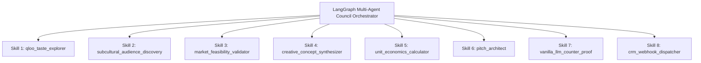

# Venture Pulse — The 8-Agent Skill Protocol
**Modular Tool Calling & Agentic Skills Specification (Qloo 250M+ Taste Graph)**

---

## 1. Overview of the Skill Suite

In Venture Pulse, autonomous sub-agents communicate and execute work through a modular **Agent Skill Suite**. Every skill adheres to strict JSON Schema contracts validated at runtime via **Zod**, preventing malformed data and ensuring high-reliability agentic tool calling across cyclic LangGraph consensus loops.



---

## 2. Detailed Skill Specifications & Zod Contracts

### Skill 1: `qloo_taste_explorer`
* **Agent Role:** Cultural Analyst
* **Purpose:** Queries Qloo’s 250M+ entity graph to resolve cultural anchors, compute cross-domain brand affinities, map multi-hop taste paths, and extract negative anti-affinity guardrails.
* **Zod Input Schema:**
  ```typescript
  import { z } from 'zod';

  export const QlooTasteExplorerInputSchema = z.object({
    anchorEntities: z.array(z.string()).min(1).max(8),
    targetDomains: z.array(z.enum(['fashion', 'beverage', 'tech', 'living', 'lifestyle', 'apparel'])),
    excludedTags: z.array(z.string()).optional(),
    minAffinityThreshold: z.number().min(0.0).max(1.0).default(0.5)
  });
  ```
* **Zod Output Schema:**
  ```typescript
  export const QlooTasteExplorerOutputSchema = z.object({
    resolvedAnchors: z.array(z.object({
      rawName: z.string(),
      qlooUrn: z.string(),
      category: z.string()
    })),
    affinityMatches: z.array(z.object({
      brandName: z.string(),
      domain: z.string(),
      affinityScore: z.number(), // e.g. 7.8 (7.8x affinity)
      overlapPercent: z.number(),
      multiHopPath: z.string(), // e.g. "Kavinsky [artist] -> Dark Minimalism [tag] -> Acne Studios [brand]"
      negativeSignals: z.string(), // e.g. "Audience indexes -4.2x against generic neon plastics"
      topGeographicClusters: z.array(z.object({
        city: z.string(),
        liftMultiplier: z.number()
      }))
    }))
  });
  ```

---

### Skill 2: `subcultural_audience_discovery`
* **Agent Role:** Cultural Strategist (Brand Mode)
* **Purpose:** Enables brands to discover unexpected high-affinity micro-communities, podcasts, and indie creators where their brand indexes $>6\times$ above baseline.
* **Zod Input Schema:**
  ```typescript
  export const SubculturalAudienceDiscoveryInputSchema = z.object({
    brandEntity: z.string(),
    targetCreatorCategories: z.array(z.enum(['Gaming', 'Podcast', 'Art', 'Music', 'Tech'])),
    minAffinityMultiplier: z.number().default(5.0)
  });
  ```
* **Zod Output Schema:**
  ```typescript
  export const SubculturalAudienceDiscoveryOutputSchema = z.object({
    matchedSubcultures: z.array(z.object({
      subcultureName: z.string(),
      creatorCategory: z.string(),
      affinityMultiplier: z.number(),
      demographicAlignmentScore: z.number(),
      recommendedActivation: z.string()
    }))
  });
  ```

---

### Skill 3: `market_feasibility_validator`
* **Agent Role:** Brand Strategist
* **Purpose:** Evaluates commercial deal sizing, sponsor budget brackets, category saturation, and brand safety, driving Cycle 1 rejection if thresholds are not met.
* **Zod Input Schema:**
  ```typescript
  export const MarketFeasibilityInputSchema = z.object({
    brandName: z.string(),
    brandDomain: z.string(),
    creatorCategory: z.string(),
    creatorAudienceTier: z.enum(['Nano (1k-10k)', 'Micro (10k-50k)', 'Mid (50k-250k)', 'Macro (250k+)', 'Enterprise ($50k+)'])
  });
  ```
* **Zod Output Schema:**
  ```typescript
  export const MarketFeasibilityOutputSchema = z.object({
    feasibilityScore: z.number().min(0).max(100),
    estimatedDealTier: z.enum(['Micro ($2k-$5k)', 'Mid ($5k-$20k)', 'High ($20k-$50k+)']),
    consensusStatus: z.enum(['APPROVED', 'REJECT_AND_REFINE']),
    rejectionReason: z.string().optional(),
    brandSafetyStatus: z.enum(['Safe', 'Moderate Caution', 'High Conflict']),
    commercialRationale: z.string()
  });
  ```

---

### Skill 4: `creative_concept_synthesizer`
* **Agent Role:** Creative Director
* **Purpose:** Merges aesthetic anchors into physical limited-edition merchandise specs with packaging aesthetics, BOM specifications, and human-in-the-loop adaptation.
* **Zod Input Schema:**
  ```typescript
  export const CreativeConceptInputSchema = z.object({
    creatorName: z.string(),
    creatorVibe: z.string(),
    brandName: z.string(),
    brandDomain: z.string(),
    culturalIntersectionTags: z.array(z.string()),
    humanConstraints: z.string().optional() // Mid-debate founder intervention
  });
  ```
* **Zod Output Schema:**
  ```typescript
  export const CreativeConceptOutputSchema = z.object({
    productTitle: z.string(),
    format: z.enum(['Limited Capsule', 'Co-Branded Packaging', 'Hardware Variant', 'Experiential Drop']),
    aestheticDescription: z.string(),
    packagingSpec: z.string(),
    targetRetailPrice: z.number(),
    dropMechanics: z.string()
  });
  ```

---

### Skill 5: `unit_economics_calculator`
* **Agent Role:** Commercial Analyst
* **Purpose:** Computes dynamic BOM financial models, Gross Merchandise Value (GMV), creator royalty payouts, and sellout velocity projections.
* **Zod Input Schema:**
  ```typescript
  export const UnitEconomicsInputSchema = z.object({
    editionRunSize: z.number().int().min(50).max(10000),
    targetRetailPrice: z.number().min(10),
    royaltySplitPct: z.number().min(0.05).max(0.5).default(0.18),
    qlooAffinityMultiplier: z.number().default(7.0)
  });
  ```
* **Zod Output Schema:**
  ```typescript
  export const UnitEconomicsOutputSchema = z.object({
    grossMerchandiseValue: z.number(),
    creatorRoyaltyPayout: z.number(),
    guaranteedSponsorFee: z.number(),
    projectedSellThroughRate: z.number(), // 0-100%
    selloutVelocityEstimate: z.string() // e.g. "48 Hours"
  });
  ```

---

### Skill 6: `pitch_architect`
* **Agent Role:** Council Executive Synthesis
* **Purpose:** Generates executive cold outreach copy embedding the mathematical Qloo proof and cultural rationale.
* **Zod Input Schema:**
  ```typescript
  export const PitchArchitectInputSchema = z.object({
    targetBrand: z.string(),
    creatorName: z.string(),
    audienceSummary: z.string(),
    productConcept: z.object({
      title: z.string(),
      description: z.string()
    }),
    qlooAffinityMultiplier: z.number()
  });
  ```
* **Zod Output Schema:**
  ```typescript
  export const PitchArchitectOutputSchema = z.object({
    subjectLine: z.string(),
    executiveHook: z.string(),
    dataProofParagraph: z.string(),
    collabProposal: z.string(),
    callToAction: z.string()
  });
  ```

---

### Skill 7: `vanilla_llm_counter_proof`
* **Agent Role:** Proof Engine Evaluator
* **Purpose:** Captures the ungrounded generic baseline output of vanilla LLMs to demonstrate the quantifiable difference made by Qloo.
* **Zod Input Schema:**
  ```typescript
  export const VanillaLlmCounterProofInputSchema = z.object({
    creatorName: z.string(),
    creatorCategory: z.string()
  });
  ```
* **Zod Output Schema:**
  ```typescript
  export const VanillaLlmCounterProofOutputSchema = z.object({
    clicheSponsors: z.array(z.string()),
    clicheMerchandise: z.array(z.string()),
    failureAnalysis: z.string()
  });
  ```

---

### Skill 8: `crm_webhook_dispatcher`
* **Agent Role:** Autonomous Action Dispatcher
* **Purpose:** Delivers finalized cards, BOM specs, and cold pitch letters to external CRM endpoints (HubSpot, Notion, or custom developer webhooks).
* **Zod Input Schema:**
  ```typescript
  export const CrmWebhookDispatcherInputSchema = z.object({
    targetService: z.enum(['HubSpot', 'Notion', 'Custom_Webhook']),
    webhookUrl: z.string().url(),
    cardPayload: z.record(z.unknown())
  });
  ```
* **Zod Output Schema:**
  ```typescript
  export const CrmWebhookDispatcherOutputSchema = z.object({
    success: z.boolean(),
    httpStatusCode: z.number(),
    responseBody: z.string(),
    dispatchedTimestamp: z.string()
  });
  ```
