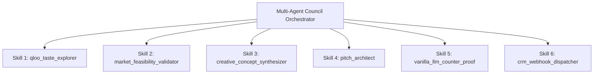

# Venture Pulse — The 6-Agent Skill Protocol
**Modular Tool Calling & Agentic Skills Specification**

---

## 1. Overview of the Skill Suite

In Venture Pulse, autonomous sub-agents communicate and execute work through a modular **Agent Skill Suite**. Every skill adheres to strict JSON Schema contracts validated at runtime via **Zod**, preventing malformed data and ensuring high-reliability agentic tool calling.



---

## 2. Detailed Skill Specifications

### Skill 1: `qloo_taste_explorer`
* **Agent Role:** Cultural Analyst
* **Purpose:** Queries Qloo’s 250M+ entity graph to resolve cultural anchors and compute cross-domain brand affinities with statistical confidence.
* **Zod Input Schema:**
  ```typescript
  import { z } from 'zod';

  export const QlooTasteExplorerInputSchema = z.object({
    anchorEntities: z.array(z.string()).min(1).max(5),
    targetDomains: z.array(z.enum(['fashion', 'beverage', 'tech', 'living', 'lifestyle'])),
    minAffinityThreshold: z.number().min(0.0).max(1.0).default(0.5)
  });
  ```
* **Zod Output Schema:**
  ```typescript
  export const QlooTasteExplorerOutputSchema = z.object({
    resolvedAnchors: z.array(z.object({
      rawName: z.string(),
      qlooId: z.string(),
      category: z.string()
    })),
    affinityMatches: z.array(z.object({
      brandName: z.string(),
      domain: z.string(),
      affinityScore: z.number(), // e.g. 7.8 (7.8x affinity)
      overlapPercent: z.number(), // 0 - 100
      crossDomainPath: z.string() // e.g. "Synthwave -> Japanese Raw Denim"
    }))
  });
  ```

---

### Skill 2: `market_feasibility_validator`
* **Agent Role:** Brand Strategist
* **Purpose:** Analyzes commercial deal sizing, sponsor budget brackets, category saturation, and brand safety.
* **Zod Input Schema:**
  ```typescript
  export const MarketFeasibilityInputSchema = z.object({
    brandName: z.string(),
    brandDomain: z.string(),
    creatorCategory: z.string(),
    creatorAudienceTier: z.enum(['Nano (1k-10k)', 'Micro (10k-50k)', 'Mid (50k-250k)', 'Macro (250k+)'])
  });
  ```
* **Zod Output Schema:**
  ```typescript
  export const MarketFeasibilityOutputSchema = z.object({
    feasibilityScore: z.number().min(0).max(100),
    estimatedDealTier: z.enum(['Micro ($2k-$5k)', 'Mid ($5k-$20k)', 'High ($20k-$50k+)']),
    sponsorBudgetProfile: z.string(),
    brandSafetyStatus: z.enum(['Safe', 'Moderate Caution', 'High Conflict']),
    commercialRationale: z.string()
  });
  ```

---

### Skill 3: `creative_concept_synthesizer`
* **Agent Role:** Creative Director
* **Purpose:** Merges the creator's aesthetic identity with the target brand's heritage into a physical limited-edition merchandise or co-branded product drop.
* **Zod Input Schema:**
  ```typescript
  export const CreativeConceptInputSchema = z.object({
    creatorName: z.string(),
    creatorVibe: z.string(),
    brandName: z.string(),
    brandDomain: z.string(),
    culturalIntersectionTags: z.array(z.string())
  });
  ```
* **Zod Output Schema:**
  ```typescript
  export const CreativeConceptOutputSchema = z.object({
    productTitle: z.string(),
    format: z.enum(['Limited Capsule', 'Co-Branded Packaging', 'Hardware Variant', 'Experiential Drop']),
    aestheticDescription: z.string(),
    packagingSpec: z.string(),
    targetRetailPrice: z.number(),
    dropMechanics: z.string()
  });
  ```

---

### Skill 4: `pitch_architect`
* **Agent Role:** Council Executive Synthesis
* **Purpose:** Generates a personalized, executive-ready cold outreach pitch email for the brand's partnership team, embedding the mathematical Qloo proof.
* **Zod Input Schema:**
  ```typescript
  export const PitchArchitectInputSchema = z.object({
    targetBrand: z.string(),
    creatorName: z.string(),
    audienceSummary: z.string(),
    productConcept: z.object({
      title: z.string(),
      description: z.string()
    }),
    qlooAffinityMultiplier: z.number()
  });
  ```
* **Zod Output Schema:**
  ```typescript
  export const PitchArchitectOutputSchema = z.object({
    subjectLine: z.string(),
    executiveHook: z.string(),
    dataProofParagraph: z.string(),
    collabProposal: z.string(),
    callToAction: z.string()
  });
  ```

---

### Skill 5: `vanilla_llm_counter_proof`
* **Agent Role:** Proof Engine Evaluator
* **Purpose:** Executes an ungrounded baseline prompt using only the creator's name and category to capture the generic cliché output of a vanilla LLM.
* **Zod Input Schema:**
  ```typescript
  export const VanillaLlmCounterProofInputSchema = z.object({
    creatorName: z.string(),
    creatorCategory: z.string()
  });
  ```
* **Zod Output Schema:**
  ```typescript
  export const VanillaLlmCounterProofOutputSchema = z.object({
    clicheSponsors: z.array(z.string()), // e.g. ["Generic VPN", "Audiobook App", "Mattress Brand"]
    clicheMerchandise: z.array(z.string()), // e.g. ["Logo T-Shirt", "Coffee Mug", "Enamel Pin"]
    failureAnalysis: z.string() // Explains why this generic recommendation converts poorly
  });
  ```

---

### Skill 6: `crm_webhook_dispatcher`
* **Agent Role:** Autonomous Action Dispatcher
* **Purpose:** Delivers the verified brand target card, product concept, and outreach pitch to external CRM endpoints (HubSpot, Notion, or custom webhooks).
* **Zod Input Schema:**
  ```typescript
  export const CrmWebhookDispatcherInputSchema = z.object({
    targetService: z.enum(['HubSpot', 'Notion', 'Custom_Webhook']),
    webhookUrl: z.string().url(),
    cardPayload: z.record(z.unknown())
  });
  ```
* **Zod Output Schema:**
  ```typescript
  export const CrmWebhookDispatcherOutputSchema = z.object({
    success: z.boolean(),
    httpStatusCode: z.number(),
    responseBody: z.string(),
    dispatchedTimestamp: z.string()
  });
  ```
