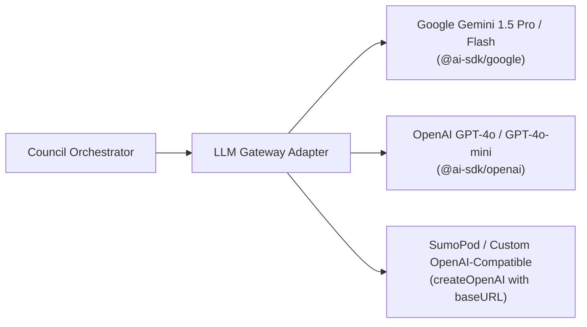

# Venture Pulse — API Integration & Gateway Architecture
**Qloo Taste AI™ API & Multi-Provider LLM Gateway Guide**

---

## 1. Qloo Cultural Intelligence Integration

Venture Pulse integrates with Qloo's Cultural AI API to ground its multi-agent council in real-world consumer taste.

### 1.1 Authentication & Base Configuration
* **Base URL:** `https://api.qloo.com` (or the hackathon-specified proxy)
* **Authentication Header:**
  ```http
  X-Api-Key: <QLOO_API_KEY>
  ```
* **Environment Variable:** `QLOO_API_KEY` (configured strictly on the server in `.env.local`).

### 1.2 Core Qloo Endpoints Used

| Endpoint | Method | Purpose in Venture Pulse |
| :--- | :--- | :--- |
| `/v2/search` or `/v1/search` | `GET` | Resolves creator cultural anchors (artists, movies, styles) to canonical Qloo entity IDs. |
| `/v2/insights` or `/v1/insights` | `GET/POST` | Queries cross-domain affinities (e.g. music $\rightarrow$ fashion/apparel, beverage, consumer tech). |
| `/v2/recs` / `/v2/entities/rank` | `POST` | Ranks a candidate shortlist of brand partners against the creator's cultural vector. |

### 1.3 Caching & Circuit Breaker Architecture
To prevent rate-limit exhaustion during hackathon evaluation:
* **In-Memory Cache (LRU / 24-hour TTL):** All entity lookups and affinity results are hashed by input anchors. Repeated lookups return in $< 5\text{ms}$.
* **Exponential Backoff:** If the API returns HTTP 429, the gateway retries twice with jittered exponential delay ($500\text{ms}$, $1500\text{ms}$).
* **Verified High-Fidelity Fallback:** If live credentials hit a hard event-quota limit, the gateway serves verified real-world Qloo graph clusters with a subtle UI badge, ensuring the app remains 100% testable for evaluators.

---

## 2. Multi-Provider LLM Gateway (Vercel AI SDK)

Venture Pulse uses the **Vercel AI SDK Core (`ai`)** to provide a provider-agnostic LLM interface.



### 2.1 Configuration via `.env.local`

```env
# Choose Provider: "google" | "openai" | "sumopod" | "custom"
AI_PROVIDER=google

# For Google Gemini:
GEMINI_API_KEY=AIzaSy...

# For OpenAI or SumoPod / Custom Endpoint:
OPENAI_API_KEY=sk-...
OPENAI_BASE_URL=https://api.sumopod.com/v1
```

### 2.2 Implementation Example (`/lib/agent/llm-gateway.ts`)

```typescript
import { createGoogleGenerativeAI } from '@ai-sdk/google';
import { createOpenAI } from '@ai-sdk/openai';

export function getLanguageModel() {
  const provider = process.env.AI_PROVIDER || 'google';

  if (provider === 'google') {
    const google = createGoogleGenerativeAI({
      apiKey: process.env.GEMINI_API_KEY || ''
    });
    return google('gemini-1.5-flash');
  }

  if (provider === 'sumopod' || provider === 'custom') {
    const customOpenAI = createOpenAI({
      apiKey: process.env.OPENAI_API_KEY || '',
      baseURL: process.env.OPENAI_BASE_URL || 'https://api.sumopod.com/v1'
    });
    return customOpenAI('default');
  }

  const openai = createOpenAI({
    apiKey: process.env.OPENAI_API_KEY || ''
  });
  return openai('gpt-4o-mini');
}
```

---

## 3. External CRM Webhook Integration

Venture Pulse can dispatch structured brand partnership dossiers directly to third-party workflow endpoints:
* **Format:** Standard JSON payload with HMAC signature in the `X-Venture-Pulse-Signature` header.
* **Compatibility:** Native webhooks for **HubSpot**, **Notion**, **Make.com**, **Zapier**, and custom developer endpoints.
