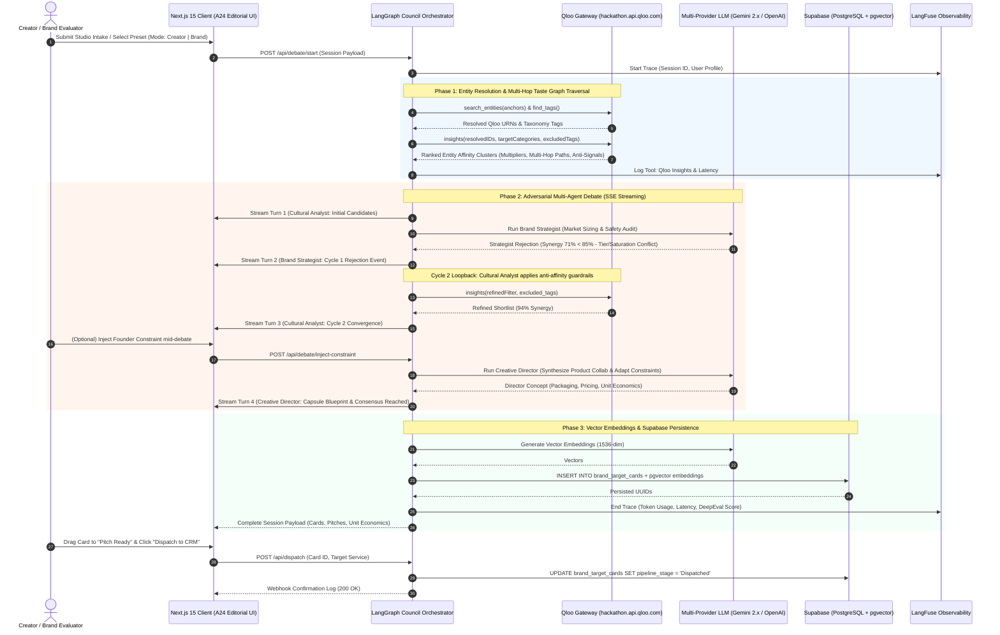
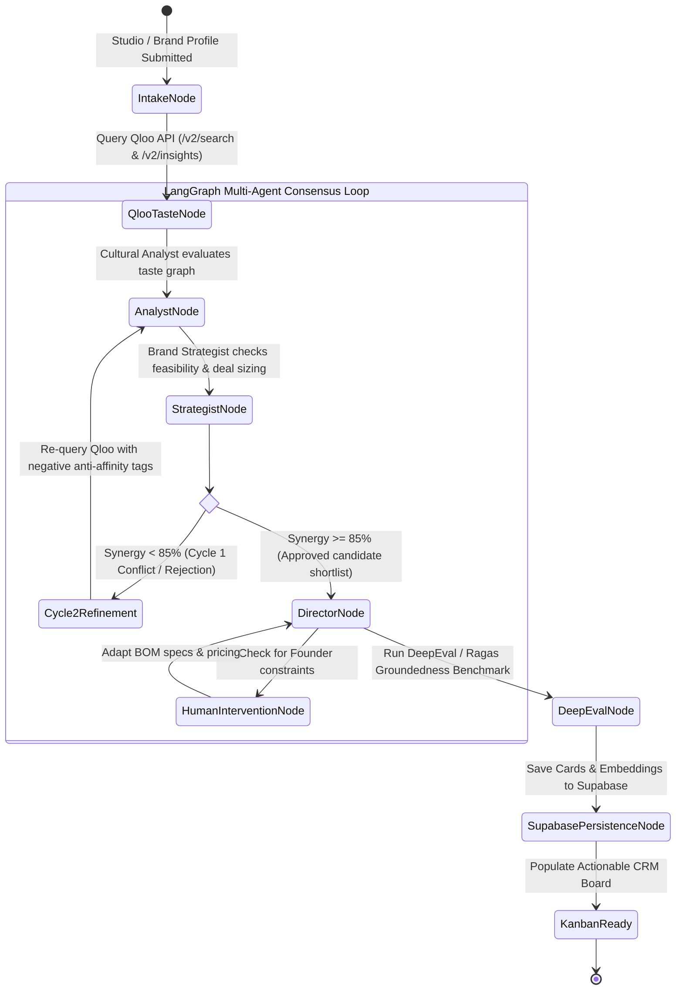
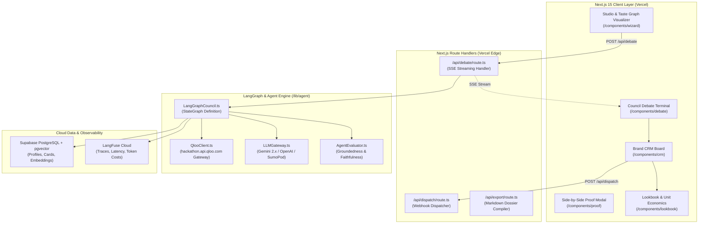

# Venture Pulse — Technical Architecture Specification
**LangGraph State Machine, Adversarial Consensus Loop, Supabase pgvector & Observability**

---

## 1. System Overview & Core Paradigms

Venture Pulse is built on five core architectural principles designed for the 2026 AI-native landscape:

1. **Deterministic Cultural Grounding:** Eliminates parametric LLM guesswork by querying Qloo's 250M+ entity Taste Graph (`hackathon.api.qloo.com`) before creative synthesis begins.
2. **Adversarial 2-Cycle LangGraph Multi-Agent Deliberation:** Coordinates specialized adversarial sub-agents (Cultural Analyst, Brand Strategist, Creative Director) within a cyclic state graph that enforces strict consensus criteria ($\ge 85\%$). Cycle 1 features explicit critique and rejection of budget or brand-safety mismatches, driving Cycle 2 refinement with anti-affinity guardrails.
3. **Bidirectional Orchestration:** Dynamically pivots between **Creator Mode** (Creator $\rightarrow$ Brands & Products) and **Brand Counter-Discovery Mode** (Brand $\rightarrow$ Untapped Subcultural Communities).
4. **Interactive Unit Economics & HTML5 CRM Pipeline:** Real-time financial calculations (GMV, royalties, sponsor fees) coupled with persistent drag-and-drop Kanban state.
5. **Observability, Vector Search & AI Evaluation:** Full telemetry via **LangFuse**, semantic similarity embeddings in **Supabase (PostgreSQL + pgvector)**, and quantitative quality benchmarks via **DeepEval / Ragas**.

---

## 2. End-to-End Sequence Diagram

---

## 3. LangGraph Agent State Machine (Cyclic Consensus Loop)

---

## 4. Component Architecture Breakdown

---

## 5. Latency, Resilience & Fallback Strategy

* **In-Memory Cache (LRU / 24-hour TTL):** All entity lookups and affinity results are hashed. Repeated lookups return in $< 5\text{ms}$.
* **HTTP 429 Exponential Backoff:** Automatically retries transient rate-limit spikes with jittered exponential delay ($500\text{ms}$, $1500\text{ms}$).
* **HTTP 422 Strict Schema Handling:** Sanitizes payloads to prevent schema mismatch errors from Qloo's API.
* **Dual-Header Authentication:** Dispatches both `Authorization: Bearer <KEY>` and `X-Api-Key: <KEY>` to ensure seamless operation across hackathon proxies and direct production endpoints.
* **High-Fidelity Pre-Seed Fallback:** 3 verified cultural profiles (*"Cyberpunk Indie Studio"*, *"Lo-Fi Botanical Podcast"*, *"Vintage Film Photographer"*) plus Brand Mode profiles ensure 100% uninterrupted judging uptime.
