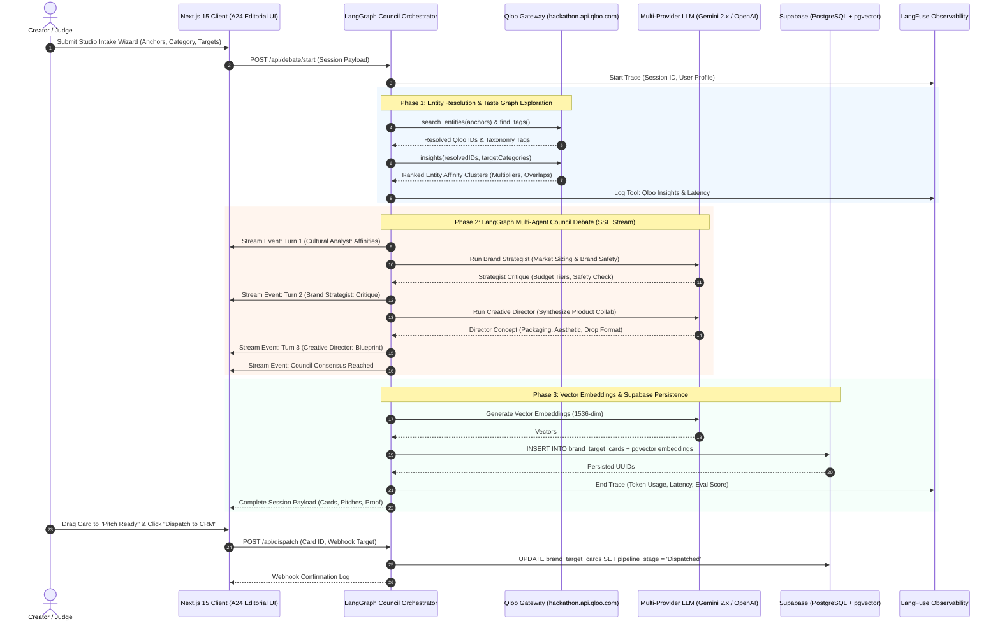
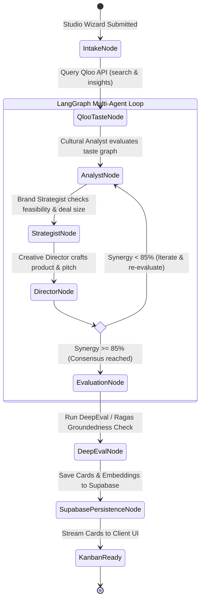
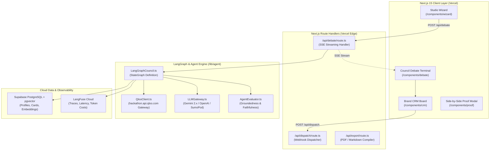

# Venture Pulse — Technical Architecture Specification
**LangGraph State Machine, Supabase pgvector, Observability & Evaluation**

---

## 1. System Overview & Core Paradigms

Venture Pulse is built on four core architectural principles designed for the 2026 AI-native landscape:

1. **Deterministic Cultural Grounding:** Eliminates parametric LLM guesswork by querying Qloo's 600M+ entity graph (`hackathon.api.qloo.com`) before creative synthesis begins.
2. **LangGraph Multi-Agent Deliberation:** Coordinates specialized adversarial sub-agents (Cultural Analyst, Brand Strategist, Creative Director) within a cyclic state graph that enforces consensus criteria.
3. **Low-Latency Streaming Execution:** Streams agent reasoning tokens and tool invocations via Server-Sent Events (SSE) so users observe decisions in real time.
4. **Supabase PostgreSQL + pgvector Persistence:** Persistent relational storage with vector embeddings for semantic brand similarity matching.
5. **Observability & Evaluation:** Complete telemetry via **LangFuse** and quantitative evaluation scores via **DeepEval / Ragas**.

---

## 2. End-to-End Sequence Diagram

---

## 3. LangGraph Agent State Machine

---

## 4. Component Architecture Breakdown

---

## 5. Latency, Resilience & Fallback Strategy

* **In-Memory Cache (LRU / 24-hour TTL):** All entity lookups and affinity results are hashed. Repeated lookups return in $< 5\text{ms}$.
* **HTTP 429 Exponential Backoff:** Automatically retries transient rate-limit spikes with jittered exponential delay.
* **HTTP 422 Strict Schema Handling:** Sanitizes payloads to prevent schema mismatch errors from Qloo's API.
* **Pre-Seed Demonstration Cache:** 3 verified cultural profiles (*"Cyberpunk Indie Studio"*, *"Lo-Fi Botanical Podcast"*, *"Vintage Film Photographer"*) are locally cached for instant, zero-latency evaluation.
