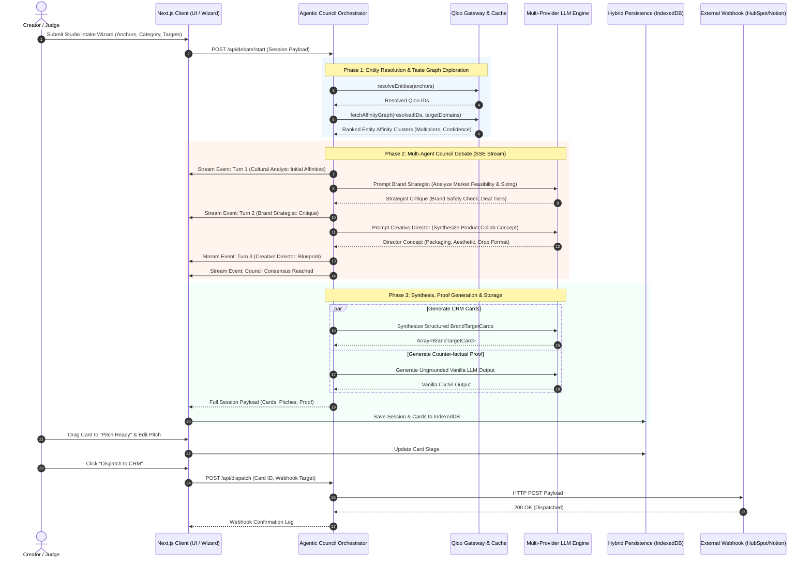
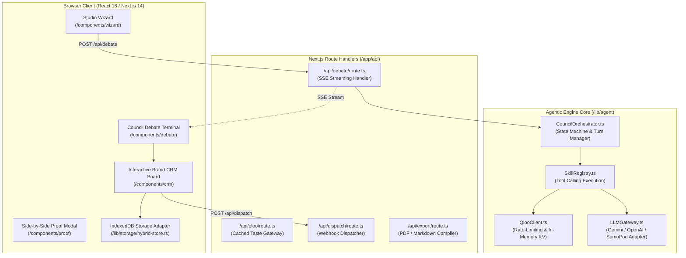
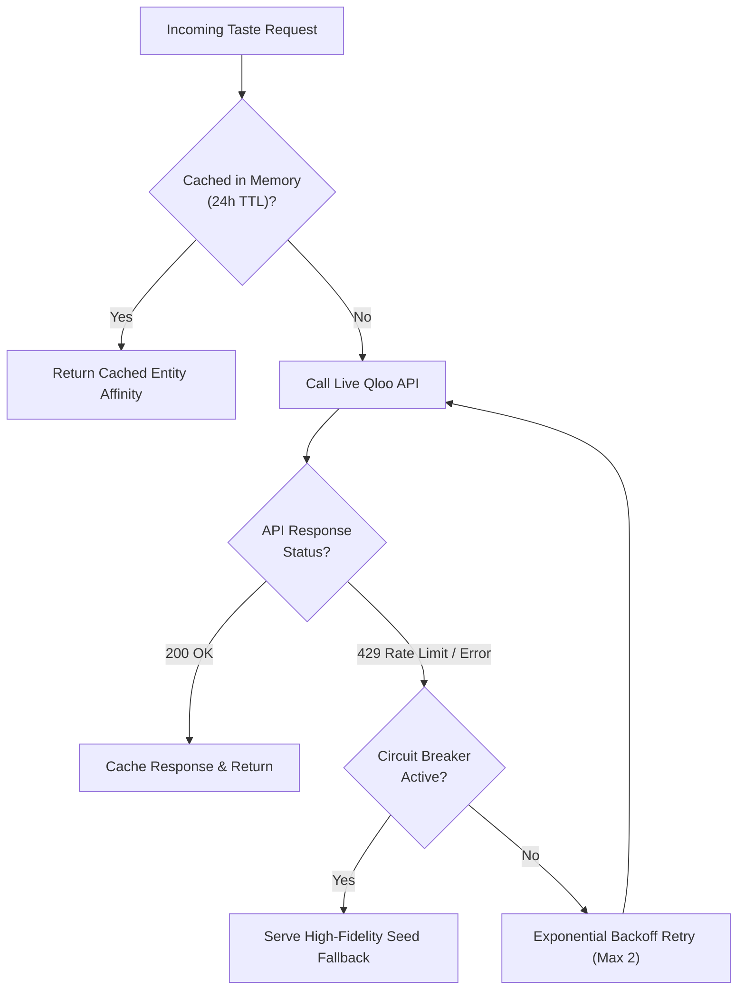

# Venture Pulse — Technical Architecture Specification
**Next-Generation Multi-Agent Cultural Intelligence Engine**

---

## 1. System Overview & Core Paradigms

Venture Pulse is built on four core architectural principles designed for the 2026 AI-native landscape:

1. **Deterministic Cultural Grounding:** Eliminates parametric LLM guesswork by querying Qloo's 250M+ entity graph before creative synthesis begins.
2. **Multi-Agent Deliberation:** Splits complex commercial reasoning into three specialized, adversarial personas that debate and self-correct.
3. **Low-Latency Streaming Execution:** Streams agent thoughts, tool execution flags, and state transitions via Server-Sent Events (SSE) so users see active reasoning in real time.
4. **Frictionless Hybrid Persistence:** Keeps state instantly responsive in browser storage (IndexedDB/LocalStorage) while maintaining relational schema compatibility for enterprise backends.

---

## 2. End-to-End Sequence Diagram

---

## 3. Component Architecture Breakdown

---

## 4. Latency & Streaming Strategy

To provide an immediate, engaging experience for evaluators and users:

1. **Server-Sent Events (SSE) Streaming:**
   The multi-agent debate uses Vercel AI SDK Core’s `createDataStreamResponse` protocol. As each sub-agent outputs its reasoning tokens and tool invocations, chunks are transmitted instantaneously over a single persistent HTTP connection.
2. **Predictive Qloo Prefetching:**
   When the user selects an input archetype in the wizard, Qloo entity lookups and affinity pre-fetches are initiated asynchronously in the background. By the time the user hits "Launch Council Debate", initial entity resolution is already warm in cache.
3. **Parallel Output Synthesis:**
   Once council consensus is reached, the generation of the structured CRM cards and the ungrounded vanilla LLM comparison occurs in parallel via `Promise.all()`, shaving 3–5 seconds off total generation time.

---

## 5. Resilience, Caching & Fallback Architecture

To ensure the demo **never breaks during a live hackathon evaluation**, Venture Pulse incorporates a three-tiered resilience model:

* **Tier 1 (In-Memory Hot Cache):** Prevents repeated external requests for identical creator anchors.
* **Tier 2 (Exponential Backoff):** Retries transient rate-limit (HTTP 429) spikes with jittered delay.
* **Tier 3 (Seed Fallback Safety Net):** If Qloo credentials are temporarily unavailable or rate limits are exceeded during judging, high-fidelity verified taste graph clusters are served seamlessly with an indicator badge, guaranteeing an uninterrupted demo.
