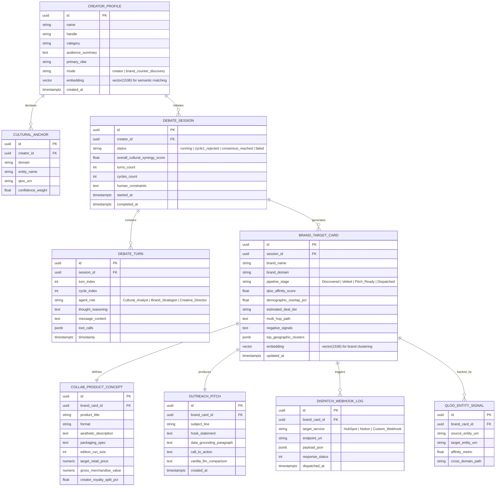

# Venture Pulse — Entity Relationship Diagram & Data Models
**Relational Schema, PostgreSQL + pgvector Migration & TypeScript Interfaces**

---

## 1. Entity Relationship Diagram (ERD)



---

## 2. PostgreSQL + pgvector Migration Schema (`supabase/migrations/001_initial_schema.sql`)

```sql
-- Enable pgvector extension for semantic cultural embeddings
CREATE EXTENSION IF NOT EXISTS vector;

-- Creator / Brand Profiles
CREATE TABLE creator_profiles (
    id UUID PRIMARY KEY DEFAULT gen_random_uuid(),
    name VARCHAR(255) NOT NULL,
    handle VARCHAR(100),
    category VARCHAR(100) NOT NULL,
    audience_summary TEXT,
    primary_vibe VARCHAR(255),
    mode VARCHAR(50) DEFAULT 'creator', -- 'creator' or 'brand_counter_discovery'
    embedding VECTOR(1536),
    created_at TIMESTAMPTZ DEFAULT NOW()
);

-- Cultural Anchors declared by creators or brands
CREATE TABLE cultural_anchors (
    id UUID PRIMARY KEY DEFAULT gen_random_uuid(),
    creator_id UUID REFERENCES creator_profiles(id) ON DELETE CASCADE,
    domain VARCHAR(50) NOT NULL,
    entity_name VARCHAR(255) NOT NULL,
    qloo_urn VARCHAR(150),
    confidence_weight FLOAT DEFAULT 1.0,
    created_at TIMESTAMPTZ DEFAULT NOW()
);

-- Multi-Agent Debate Sessions
CREATE TABLE debate_sessions (
    id UUID PRIMARY KEY DEFAULT gen_random_uuid(),
    creator_id UUID REFERENCES creator_profiles(id) ON DELETE CASCADE,
    status VARCHAR(50) DEFAULT 'running',
    overall_cultural_synergy_score FLOAT,
    turns_count INT DEFAULT 0,
    cycles_count INT DEFAULT 1,
    human_constraints TEXT,
    started_at TIMESTAMPTZ DEFAULT NOW(),
    completed_at TIMESTAMPTZ
);

-- Multi-Agent Debate Turns (Live Thought Stream & Tool Calls)
CREATE TABLE debate_turns (
    id UUID PRIMARY KEY DEFAULT gen_random_uuid(),
    session_id UUID REFERENCES debate_sessions(id) ON DELETE CASCADE,
    turn_index INT NOT NULL,
    cycle_index INT DEFAULT 1,
    agent_role VARCHAR(100) NOT NULL,
    thought_reasoning TEXT,
    message_content TEXT,
    tool_calls JSONB,
    timestamp TIMESTAMPTZ DEFAULT NOW()
);

-- Brand Target Cards (Kanban Pipeline Items)
CREATE TABLE brand_target_cards (
    id UUID PRIMARY KEY DEFAULT gen_random_uuid(),
    session_id UUID REFERENCES debate_sessions(id) ON DELETE CASCADE,
    brand_name VARCHAR(255) NOT NULL,
    brand_domain VARCHAR(100) NOT NULL,
    pipeline_stage VARCHAR(50) DEFAULT 'Discovered',
    qloo_affinity_score FLOAT NOT NULL,
    demographic_overlap_pct FLOAT,
    estimated_deal_tier VARCHAR(100),
    multi_hop_path TEXT,
    negative_signals TEXT,
    top_geographic_clusters JSONB,
    embedding VECTOR(1536),
    updated_at TIMESTAMPTZ DEFAULT NOW()
);

-- Physical Collaboration Concepts & Unit Economics
CREATE TABLE collab_product_concepts (
    id UUID PRIMARY KEY DEFAULT gen_random_uuid(),
    brand_card_id UUID REFERENCES brand_target_cards(id) ON DELETE CASCADE,
    product_title VARCHAR(255) NOT NULL,
    format VARCHAR(100),
    aesthetic_description TEXT,
    packaging_spec TEXT,
    edition_run_size INT DEFAULT 500,
    target_retail_price NUMERIC(10, 2) NOT NULL,
    gross_merchandise_value NUMERIC(12, 2),
    creator_royalty_split_pct FLOAT DEFAULT 0.18,
    created_at TIMESTAMPTZ DEFAULT NOW()
);

-- Personalized Outreach Pitch Letters
CREATE TABLE outreach_pitches (
    id UUID PRIMARY KEY DEFAULT gen_random_uuid(),
    brand_card_id UUID REFERENCES brand_target_cards(id) ON DELETE CASCADE,
    subject_line VARCHAR(255) NOT NULL,
    hook_statement TEXT,
    data_grounding_paragraph TEXT,
    call_to_action TEXT,
    vanilla_llm_comparison TEXT,
    created_at TIMESTAMPTZ DEFAULT NOW()
);

-- Outbound Webhook Logs
CREATE TABLE dispatch_webhook_logs (
    id UUID PRIMARY KEY DEFAULT gen_random_uuid(),
    brand_card_id UUID REFERENCES brand_target_cards(id) ON DELETE CASCADE,
    target_service VARCHAR(100) NOT NULL,
    endpoint_url TEXT NOT NULL,
    payload_json JSONB NOT NULL,
    response_status INT,
    dispatched_at TIMESTAMPTZ DEFAULT NOW()
);

-- Indexes for vector similarity search
CREATE INDEX ON creator_profiles USING ivfflat (embedding vector_cosine_ops) WITH (lists = 100);
CREATE INDEX ON brand_target_cards USING ivfflat (embedding vector_cosine_ops) WITH (lists = 100);
```

---

## 3. TypeScript Interfaces

```typescript
export type CreatorCategory = 'Gaming' | 'Podcast' | 'Music' | 'Art' | 'Tech' | 'Living' | 'Lifestyle';
export type WorkflowMode = 'creator' | 'brand_counter_discovery';

export interface CulturalAnchor {
  id: string;
  creatorId: string;
  domain: 'music' | 'film' | 'fashion' | 'dining' | 'literature' | 'aesthetic';
  entityName: string;
  qlooUrn?: string;
  confidenceWeight: number; // 0.0 - 1.0
}

export interface CreatorProfile {
  id: string;
  name: string;
  handle: string;
  category: CreatorCategory;
  audienceSummary: string;
  primaryVibe: string;
  mode: WorkflowMode;
  anchors: CulturalAnchor[];
  embedding?: number[];
  createdAt: string;
}

export type AgentRole = 'Cultural_Analyst' | 'Brand_Strategist' | 'Creative_Director';

export interface DebateTurn {
  id: string;
  sessionId: string;
  turnIndex: number;
  cycleIndex: number;
  agentRole: AgentRole;
  thoughtReasoning: string;
  messageContent: string;
  toolCalls?: {
    toolName: string;
    input: Record<string, unknown>;
    output: Record<string, unknown>;
  }[];
  timestamp: string;
}

export interface DebateSession {
  id: string;
  creatorId: string;
  status: 'idle' | 'running' | 'cycle1_rejected' | 'consensus_reached' | 'failed';
  overallCulturalSynergyScore: number;
  cyclesCount: number;
  humanConstraints?: string;
  turns: DebateTurn[];
  startedAt: string;
  completedAt?: string;
}

export type PipelineStage = 'Discovered' | 'Vetted' | 'Pitch Ready' | 'Dispatched';
export type DealTier = 'Micro ($2k-$5k)' | 'Mid ($5k-$20k)' | 'High ($20k-$50k+)' | 'Enterprise ($50k+)';

export interface CollabProductConcept {
  id: string;
  brandCardId: string;
  productTitle: string;
  format: 'Limited Capsule' | 'Co-Branded Packaging' | 'Hardware Variant' | 'Experiential Drop';
  aestheticDescription: string;
  packagingSpec: string;
  editionRunSize: number;
  targetRetailPrice: number;
  grossMerchandiseValue: number;
  creatorRoyaltySplitPct: number;
}

export interface OutreachPitch {
  id: string;
  brandCardId: string;
  subjectLine: string;
  hookStatement: string;
  dataGroundingParagraph: string;
  callToAction: string;
  vanillaLlmComparison: string;
}

export interface BrandTargetCard {
  id: string;
  sessionId: string;
  brandName: string;
  brandDomain: 'apparel' | 'beverage' | 'tech' | 'living' | 'lifestyle';
  pipelineStage: PipelineStage;
  qlooAffinityScore: number;
  demographicOverlapPct: number;
  estimatedDealTier: DealTier;
  multiHopPath: string;
  negativeSignals: string;
  topGeographicClusters: Array<{ city: string; lift: number }>;
  embedding?: number[];
  productConcept: CollabProductConcept;
  pitch: OutreachPitch;
  dispatchLogs: Array<{
    targetService: string;
    endpointUrl: string;
    responseStatus: number;
    dispatchedAt: string;
  }>;
  updatedAt: string;
}
```
