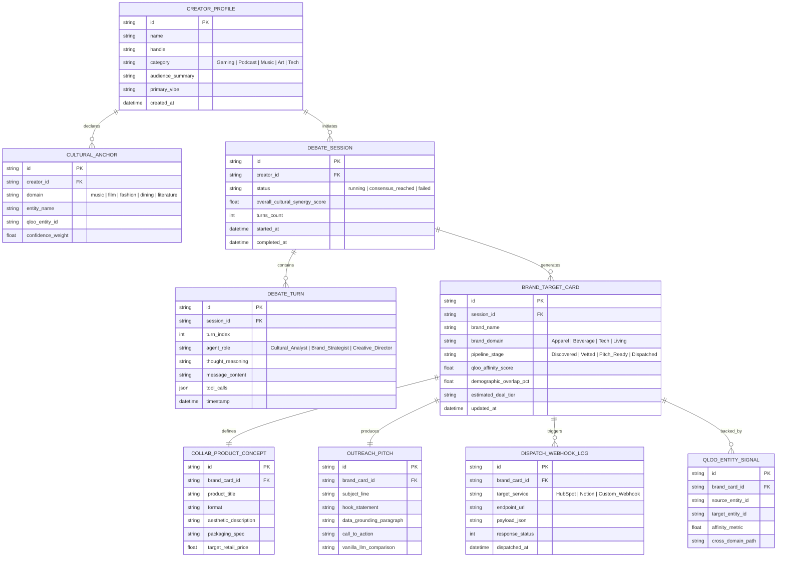

# Venture Pulse — Entity Relationship Diagram & Data Models
**Relational Schema & TypeScript Interface Specifications**

---

## 1. Entity Relationship Diagram (ERD)



---

## 2. TypeScript Data Interfaces

These interfaces govern all client-side state, API responses, and database mappings across the codebase:

```typescript
export type CreatorCategory = 'Gaming' | 'Podcast' | 'Music' | 'Art' | 'Tech' | 'Lifestyle';

export interface CulturalAnchor {
  id: string;
  creatorId: string;
  domain: 'music' | 'film' | 'fashion' | 'dining' | 'literature' | 'aesthetic';
  entityName: string;
  qlooEntityId?: string;
  confidenceWeight: number; // 0.0 - 1.0
}

export interface CreatorProfile {
  id: string;
  name: string;
  handle: string;
  category: CreatorCategory;
  audienceSummary: string;
  primaryVibe: string;
  anchors: CulturalAnchor[];
  createdAt: string;
}

export type AgentRole = 'Cultural_Analyst' | 'Brand_Strategist' | 'Creative_Director';

export interface DebateTurn {
  id: string;
  sessionId: string;
  turnIndex: number;
  agentRole: AgentRole;
  thoughtReasoning: string;
  messageContent: string;
  toolCalls?: {
    toolName: string;
    input: Record<string, unknown>;
    output: Record<string, unknown>;
  }[];
  timestamp: string;
}

export interface DebateSession {
  id: string;
  creatorId: string;
  status: 'idle' | 'running' | 'consensus_reached' | 'failed';
  overallCulturalSynergyScore: number; // 0 - 100
  turns: DebateTurn[];
  startedAt: string;
  completedAt?: string;
}

export type PipelineStage = 'Discovered' | 'Vetted' | 'Pitch_Ready' | 'Dispatched';
export type DealTier = 'Micro ($2k-$5k)' | 'Mid ($5k-$20k)' | 'High ($20k-$50k+)';

export interface CollabProductConcept {
  id: string;
  brandCardId: string;
  productTitle: string;
  format: 'Limited Capsule' | 'Co-Branded Packaging' | 'Hardware Variant' | 'Experiential Drop';
  aestheticDescription: string;
  packagingSpec: string;
  targetRetailPrice: number;
}

export interface OutreachPitch {
  id: string;
  brandCardId: string;
  subjectLine: string;
  hookStatement: string;
  dataGroundingParagraph: string; // The mathematical Qloo citation
  callToAction: string;
  vanillaLlmComparison: string; // Counter-factual ungrounded baseline
}

export interface QlooEntitySignal {
  id: string;
  brandCardId: string;
  sourceEntityName: string;
  targetEntityName: string;
  affinityMetric: number; // e.g. 7.8x affinity
  crossDomainPath: string; // e.g. "Synthwave -> Japanese Raw Denim"
}

export interface DispatchWebhookLog {
  id: string;
  brandCardId: string;
  targetService: 'HubSpot' | 'Notion' | 'Custom_Webhook';
  endpointUrl: string;
  payloadJson: Record<string, unknown>;
  responseStatus: number;
  dispatchedAt: string;
}

export interface BrandTargetCard {
  id: string;
  sessionId: string;
  brandName: string;
  brandDomain: 'Apparel' | 'Beverage' | 'Tech' | 'Living' | 'Cosmetics';
  pipelineStage: PipelineStage;
  qlooAffinityScore: number; // e.g. 7.8 (meaning 7.8x baseline affinity)
  demographicOverlapPct: number; // 0 - 100
  estimatedDealTier: DealTier;
  signals: QlooEntitySignal[];
  productConcept: CollabProductConcept;
  pitch: OutreachPitch;
  dispatchLogs: DispatchWebhookLog[];
  updatedAt: string;
}
```

---

## 3. Storage Architecture: Client-First Hybrid Model

To guarantee **zero friction for hackathon judges** while maintaining **enterprise production standards**:

1. **Browser Layer (IndexedDB via `idb-keyval`):**
   - Automatically initializes on page load.
   - Provides instantaneous read/write latency without requiring judges to sign up or log in.
   - Preserves state across browser tab refreshes.
2. **Export Layer:**
   - Serializes the entire session state into exportable JSON or Markdown dossier with a single click.
3. **Enterprise PostgreSQL / Prisma Schema (Ready to Deploy):**
   - A companion Prisma schema (`prisma/schema.prisma`) mirrors the TypeScript interfaces 1:1, allowing instant migration to Supabase, Neon, or Railway PostgreSQL by setting `DATABASE_URL`.
