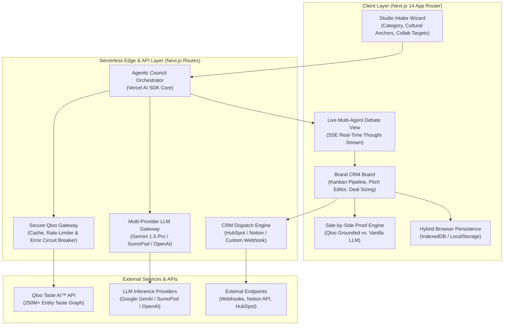
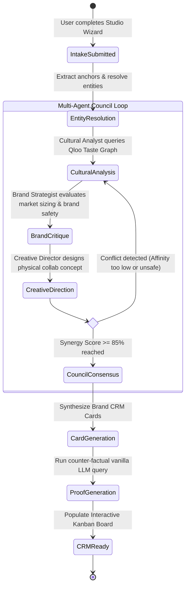
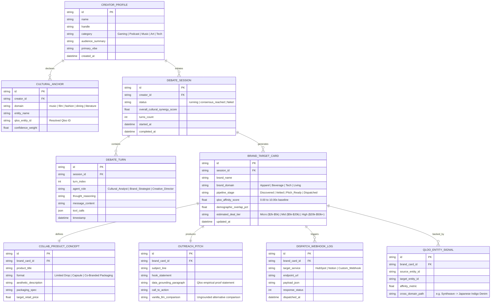
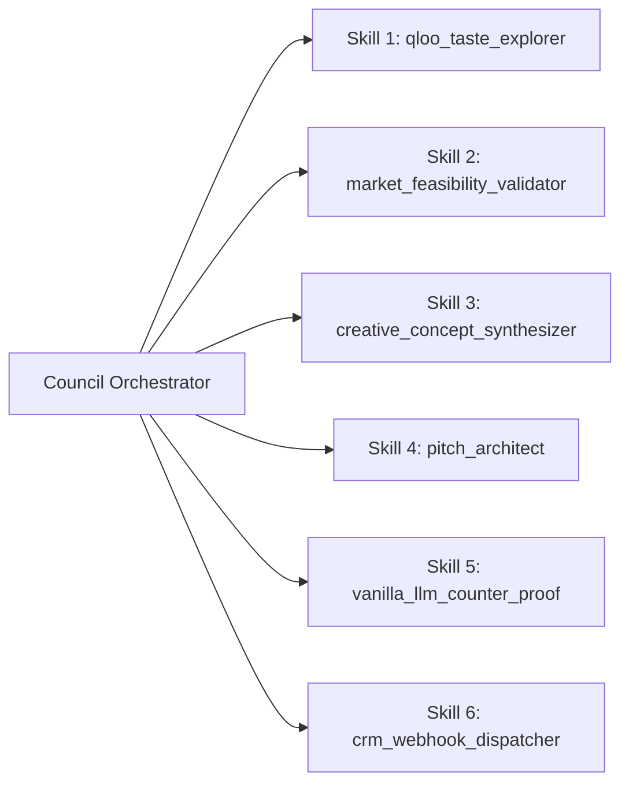
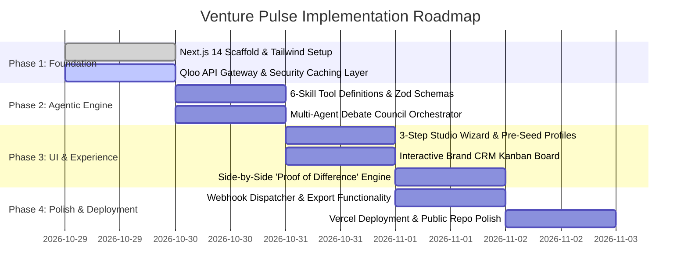

# Venture Pulse — Masterplan & Technical Architecture Specification
**Autonomous Cultural Intelligence & Brand Collaboration Agent for Creators & Indie Studios**

> **Hackathon Track:** Qloo Agentic Hackathon 2026  
> **Core Differentiator:** Grounds agentic commercial decision-making in Qloo’s 250M+ entity Taste Graph, replacing generic LLM hallucinations with empirical cross-domain affinity data.

---

## 1. Executive Summary & The Cultural Grounding Imperative

### 1.1 The Problem: The Cultural Blindness of Modern AI
Modern Large Language Models (LLMs) can plan, code, and write persuasive prose, but when tasked with commercial strategy, brand partnerships, or merchandise design, they are **culturally blind**. When an indie game studio or podcaster asks an ungrounded LLM for brand sponsors or merchandise ideas, the model defaults to bland, generic clichés:
- *"Sell logo t-shirts, tote bags, and coffee mugs."*
- *"Pitch generic brands like NordVPN, Audible, or Casper mattresses."*

These generic recommendations fail because they ignore the nuanced, multi-dimensional subcultures of modern audiences. 

### 1.2 The Solution: Venture Pulse
**Venture Pulse** is an AI-native agentic platform that pairs a **Multi-Agent Council** with **Qloo’s Cultural Taste Graph** (250M+ entities across music, film, dining, fashion, literature, and lifestyle). 

Instead of guessing, Venture Pulse:
1. Translates a creator's artistic and aesthetic footprint into verified Qloo taste nodes.
2. Traverses cross-domain graph edges to reveal non-obvious, mathematically verified audience affinities (e.g. an anime lo-fi creator whose audience unexpectedly indexes 7.8× higher for artisanal matcha brands and mechanical keyboard aesthetics).
3. Executes a live **Multi-Agent Debate** (Cultural Analyst, Brand Strategist, Creative Director) to filter for market feasibility, sizing, and aesthetic coherence.
4. Produces an **Actionable Brand CRM Board** (Kanban pipeline) with data-backed pitch drafts, custom product collaboration specs, and automated CRM webhook dispatching.
5. Features an interactive **"Proof Engine"** side-by-side view contrasting Qloo-grounded intelligence against ungrounded vanilla LLM hallucinations.

---

## 2. System Architecture & Agent State Machine

### 2.1 High-Level System Architecture



### 2.2 Multi-Agent Debate State Machine



---

## 3. Data Architecture & Entity Relationship Diagram (ERD)

### 3.1 Entity Relationship Diagram



### 3.2 Data Persistence Strategy: The Frictionless Hybrid Model
1. **Zero-Login Judge Evaluation (Client-First):**
   - The application boots with zero barrier to entry. State is immediately initialized in browser storage (`IndexedDB` via `idb-keyval` or `localStorage`).
   - Judges can test custom profiles, re-run debates, drag cards across Kanban stages, and refresh the browser without losing their generated data.
2. **Deterministic Pre-Seed Profiles:**
   - 3 pre-built creator archetypes (*"Neo-Tokyo Cyberpunk Indie Studio"*, *"Lo-Fi Botanical Wellness Podcast"*, *"Vintage Vinyl & Analog Camera Creator"*) are cached locally for instantaneous, latency-free evaluation.
3. **Export & Portability:**
   - Single-click export of the entire session into clean Markdown dossier or structured JSON.
   - Ready-to-connect Prisma/PostgreSQL schema included in the codebase for enterprise deployment.

---

## 4. The 6-Agent Skill Protocol & Tool Calling Schema

Venture Pulse utilizes a modular tool-calling architecture conforming to modern 2026 AI-Native agent standards.



### Skill 1: `qloo_taste_explorer`
* **Purpose:** Interfaces with Qloo's API to resolve input entities and discover cross-domain brand affinities.
* **Input Schema:**
  ```json
  {
    "anchor_entities": ["str"],
    "target_domains": ["brand", "fashion", "food_beverage", "consumer_tech"],
    "min_affinity_threshold": 0.65
  }
  ```
* **Output:** Ranked array of verified cultural entities, cross-category affinity scores, and bridge correlation paths.

### Skill 2: `market_feasibility_validator`
* **Purpose:** Evaluates brand partnership feasibility, brand safety, sponsor tiers, and realistic commercial deal sizing.
* **Input Schema:**
  ```json
  {
    "brand_name": "str",
    "creator_category": "str",
    "creator_audience_size_tier": "nano | micro | mid | macro"
  }
  ```
* **Output:** Feasibility index (0-100), deal sizing tier ($2k–$50k+), category exclusivity conflicts, and brand safety flags.

### Skill 3: `creative_concept_synthesizer`
* **Purpose:** Merges the creator's aesthetic with the target brand's heritage into a tangible physical collaboration concept.
* **Input Schema:**
  ```json
  {
    "creator_vibe": "str",
    "brand_name": "str",
    "cultural_intersection_tags": ["str"]
  }
  ```
* **Output:** Product title, physical packaging aesthetic, materials palette, limited-drop mechanics, and retail price bracket.

### Skill 4: `pitch_architect`
* **Purpose:** Generates high-converting, personalized cold outreach emails backed by statistical Qloo citations.
* **Input Schema:**
  ```json
  {
    "target_brand": "str",
    "product_concept": "object",
    "qloo_affinity_stat": "str"
  }
  ```
* **Output:** Subject line, executive hook, empirical proof paragraph, and collaboration proposal.

### Skill 5: `vanilla_llm_counter_proof`
* **Purpose:** Executes an ungrounded counter-factual prompt to illustrate to the judges what generic AI suggests vs. Qloo.
* **Input Schema:**
  ```json
  {
    "creator_description": "str"
  }
  ```
* **Output:** Generic/cliché LLM output (e.g. coffee mug, generic logo tee) with comparative analysis highlighting the difference.

### Skill 6: `crm_webhook_dispatcher`
* **Purpose:** Dispatches the finalized brand cards and pitch drafts to external workflows (HubSpot, Notion, or custom webhook).
* **Input Schema:**
  ```json
  {
    "target_service": "hubspot | notion | custom_webhook",
    "webhook_url": "str",
    "card_payload": "object"
  }
  ```
* **Output:** Dispatch status, timestamp, request/response payload log.

---

## 5. Security, Privacy & API Key Protection

To guarantee production security and protect hackathon credentials:

### 5.1 Architecture-Level Key Isolation
1. **Zero Client Exposure:**
   - `QLOO_API_KEY` and all LLM keys (`GEMINI_API_KEY`, `OPENAI_API_KEY`, etc.) reside strictly within the serverless environment (`process.env`).
   - Next.js server actions and API route handlers act as an isolated proxy. No private key is ever bundled into client-side JavaScript.
2. **Strict Git Guardian Protocol:**
   - `.gitignore` explicitly blocks all `.env`, `.env.local`, `.env.*.local`, and credential files.
   - Pre-commit hygiene ensures no API keys or Bearer tokens ever enter source control.
3. **Runtime In-Memory Secrets:**
   - Keys supplied via UI for custom testing are stored exclusively in memory during the active session and never logged to telemetry or disk.

### 5.2 Resilient API Gateway & Rate-Limit Circuit Breaker
- **Taste Graph Response Cache:** Qloo entity resolution and affinity queries are cached in an in-memory/KV cache with a 24-hour TTL, preventing redundant API calls and conserving rate limits.
- **Graceful Mock Fallback Mode:** If external API rate limits are exhausted during live judging, the gateway seamlessly fails over to high-fidelity cached cultural clusters, ensuring the demo never crashes or shows a broken state.

---

## 6. 2026 AI-Native Best Practices Checklist

| Best Practice | How Venture Pulse Implements It |
| :--- | :--- |
| **Deterministic Cultural Grounding** | Replaces stochastic hallucination with empirical graph edges from Qloo's 250M+ entity graph. |
| **Multi-Agent Deliberation & Self-Correction** | 3 specialized personas (Cultural Analyst, Brand Strategist, Creative Director) debate and cross-validate before outputting recommendations. |
| **Real-Time Streaming States (SSE)** | Live thought tokens and tool-call indicators stream to the user in real time for total observability. |
| **Strict JSON Schema Enforcement** | All agent tool inputs and outputs are validated via Zod schemas, eliminating malformed outputs. |
| **Action-Oriented Agency** | The agent doesn't just offer conversational advice; it writes specs, stages CRM cards, and dispatches real webhooks. |
| **Frictionless Zero-Login UX** | Judges can experience 100% of the platform instantly without account creation friction. |

---

## 7. Sprint Roadmap & Implementation Plan



### Phase-by-Phase Deliverables:
- **Phase 1: Foundation & Security Setup**
  - Initialize Next.js 14 project with TypeScript, Tailwind CSS, Lucide icons, and Shadcn UI components.
  - Implement protected `.env.local` configuration and the secure Qloo API client with rate-limit caching.
- **Phase 2: Multi-Agent Council & Tool Protocol**
  - Implement the 6 specialized agent skills using Vercel AI SDK Core.
  - Construct the streaming Multi-Agent Debate engine (Analyst $\leftrightarrow$ Strategist $\leftrightarrow$ Director).
- **Phase 3: Studio Wizard & Brand CRM Kanban UI**
  - Build the 3-step Studio Intake Wizard with quick-fill sample presets.
  - Build the real-time debate visualizer and the interactive Drag-and-Drop Brand CRM Board.
  - Build the "Proof Engine" split view comparing vanilla LLM output vs. Qloo-grounded data.
- **Phase 4: Webhook Dispatch, Export & Vercel Deployment**
  - Wire the autonomous webhook dispatcher (HubSpot/Notion simulation).
  - Deploy to Vercel and generate public, live testing URL.
  - Publish public repository with MIT License and submission write-up.
