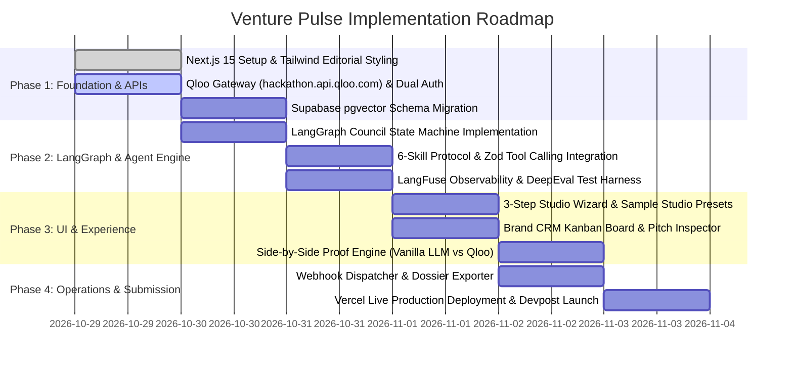

# Venture Pulse — Masterplan & Technical Architecture Specification
**Autonomous Cultural Intelligence & Brand Collaboration Agent for Creators & Indie Studios**

> **Hackathon Track:** Qloo Agentic Hackathon 2026  
> **Core Differentiator:** Grounds commercial agentic decision-making in Qloo’s 600M+ entity Taste Graph and 100T+ taste signals (`hackathon.api.qloo.com`), replacing generic LLM hallucinations with empirical cross-domain affinity data.

---

## 1. Executive Summary & The Cultural Grounding Imperative

### 1.1 The Problem: The Cultural Blindness of Modern AI
Modern Large Language Models (LLMs) can plan, code, and write persuasive prose, but when tasked with commercial strategy, brand partnerships, or merchandise design, they are **culturally blind**. When an indie game studio or podcaster asks an ungrounded LLM for brand sponsors or merchandise ideas, the model defaults to bland, generic clichés:
- *"Sell logo t-shirts, tote bags, and coffee mugs."*
- *"Pitch generic brands like NordVPN, Audible, or Casper mattresses."*

These generic recommendations fail because they ignore the nuanced, multi-dimensional subcultures of modern audiences. 

### 1.2 The Solution: Venture Pulse
**Venture Pulse** is an AI-native agentic platform that pairs a **LangGraph Multi-Agent Council** with **Qloo’s Cultural Taste Graph** (600M+ entities across music, film, dining, fashion, literature, and lifestyle). 

Instead of guessing, Venture Pulse:
1. Translates a creator's artistic and aesthetic footprint into verified Qloo taste nodes using official Qloo tools (`search_entities`, `find_tags`, `describe_entities`).
2. Traverses cross-domain graph edges via Qloo's `/v2/insights` to reveal non-obvious, mathematically verified audience affinities (e.g. an anime lo-fi creator whose audience unexpectedly indexes 7.8× higher for artisanal matcha brands and mechanical keyboard aesthetics).
3. Executes a live **LangGraph Multi-Agent Debate** (Cultural Analyst, Brand Strategist, Creative Director) to filter for market feasibility, sizing, and aesthetic coherence.
4. Stores verified profiles, cards, and semantic vector embeddings in **Supabase (PostgreSQL + pgvector)**.
5. Monitors token usage, latency, and agent trace trees with **LangFuse** and scores agent output quality using **DeepEval / Ragas**.
6. Produces an **Actionable Brand CRM Board** (Kanban pipeline) with data-backed pitch drafts, custom product collaboration specs, and automated CRM webhook dispatching.
7. Features an interactive **"Proof Engine"** side-by-side view contrasting Qloo-grounded intelligence against ungrounded vanilla LLM hallucinations.

---

## 2. 2026 AI-Native Tech Stack Matrix

| Layer | Technology | Deployment | Function |
| :--- | :--- | :--- | :--- |
| **Frontend & UI** | Next.js 15 (App Router), Tailwind CSS, `Instrument Serif` | **Vercel** | A24/Hypebeast editorial luxury interface, Mobile-Responsive First. |
| **Agent Orchestrator** | **LangGraph** (`@langchain/langgraph`) | **Vercel Serverless Edge** | Cyclic state machine managing Analyst $\leftrightarrow$ Strategist $\leftrightarrow$ Director. |
| **Cultural AI** | **Qloo Taste AI™ API** (`hackathon.api.qloo.com`) | External | 600M+ entities, 100T+ signals, dual-header authentication. |
| **Database & Vector** | **Supabase (PostgreSQL + pgvector)** | **Supabase Cloud** | Relational persistence + semantic vector embeddings for brand clustering. |
| **Observability** | **LangFuse** | **LangFuse Cloud** | Real-time trace trees, latency tracking, and cost monitoring. |
| **AI Evaluation** | **DeepEval / Ragas** | Automated Test Suite | Quantitative scoring of Groundedness, Faithfulness, and Hallucination Rate. |
| **LLM Gateway** | Vercel AI SDK Core (Gemini 2.x / OpenAI / SumoPod) | Serverless | Multi-provider routing with native structured output (`generateObject`). |
| **Ecosystem Package** | **skills.sh Open Registry Kit** | GitHub | Reusable skill package installable via `npx skills add <username>/venture-pulse`. |

---

## 3. Sprint Roadmap & Implementation Plan

